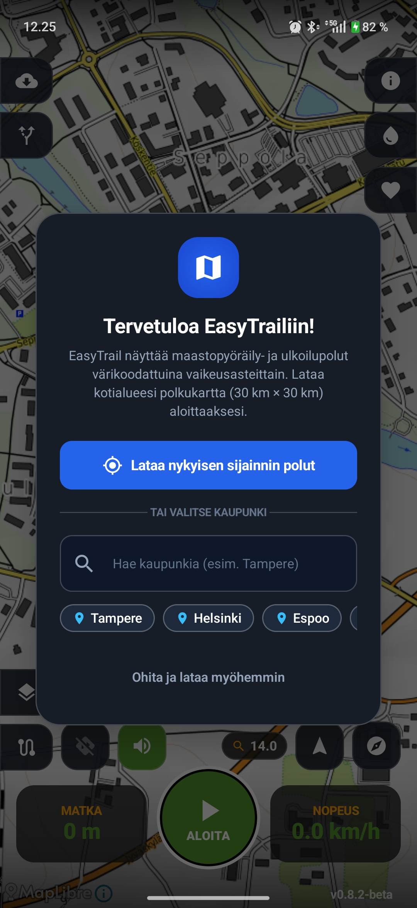
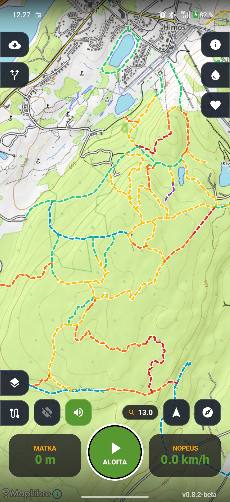
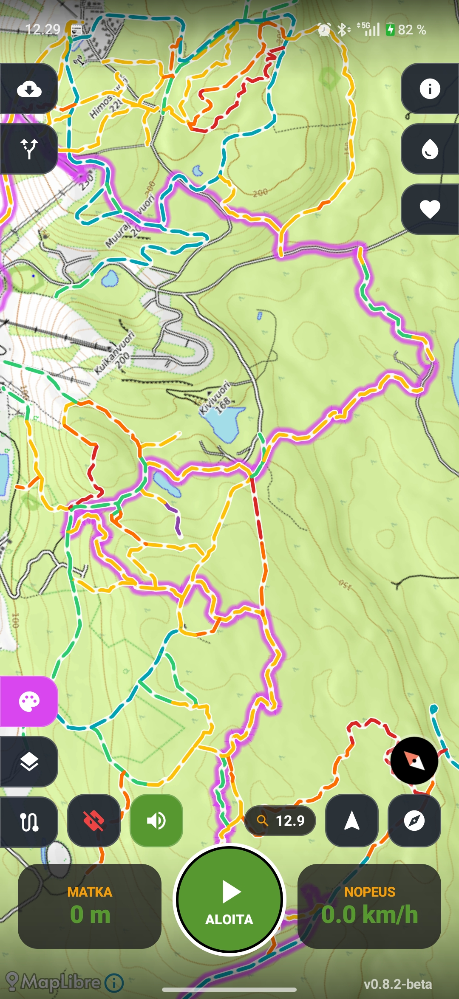
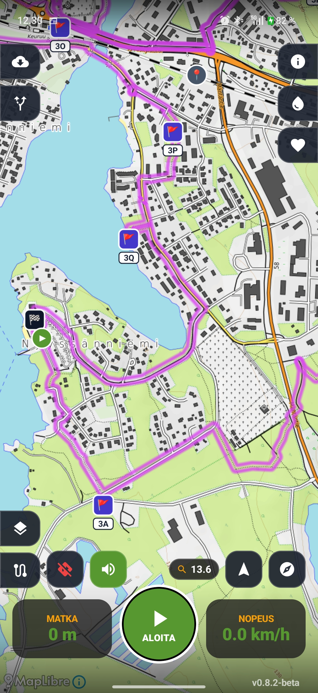
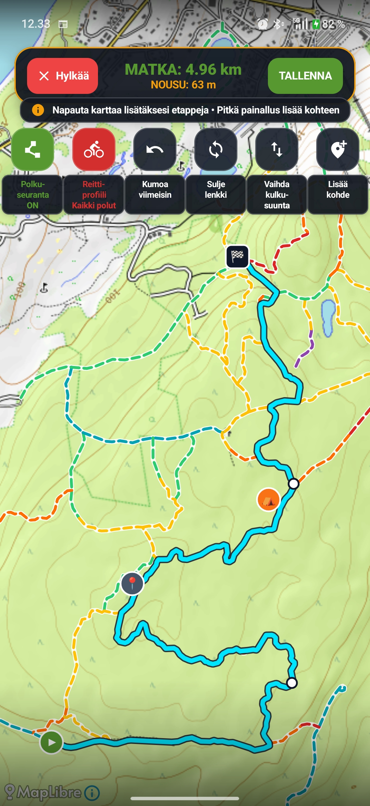
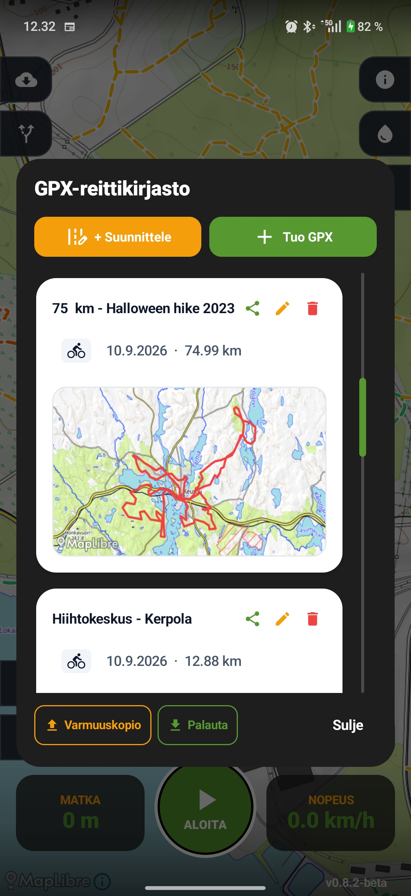
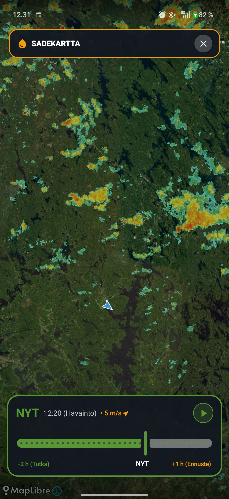
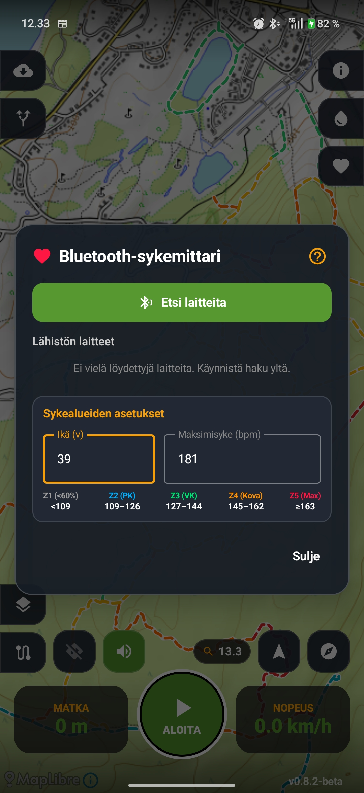

# EasyTrail – Käyttöohje ja opas maastoon

Tämä opas neuvoo sinut vaihe vaiheelta EasyTrailin käyttöön ennen lenkkiä, polulla ja lenkin jälkeen, sekä esittelee sovelluksen kaikki ominaisuudet ja painikkeet.

## Sisällysluettelo
1. [Luku 1: Käyttöönotto, luvat ja taustatoiminnan varmistus](#luku-1-kayttoonotto-luvat-ja-taustatoiminnan-varmistus)
2. [Luku 2: Päänäkymä, kartan hallinta ja maaston lukeminen](#luku-2-paanakyma-kartan-hallinta-ja-maaston-lukeminen)
3. [Luku 3: Polkukartta-aineistot ja offline-kartat](#luku-3-polkukartta-aineistot-ja-offline-kartat)
4. [Luku 4: Lenkin tallentaminen, ajonäyttö ja maastonavigointi](#luku-4-lenkin-tallentaminen-ajonaytto-ja-maastonavigointi)
5. [Luku 5: Reittipisteet (+ Rasti) ja älykkäät maastohälytykset](#luku-5-reittipisteet--rasti-ja-alykkaat-maastohalytykset)
6. [Luku 6: Reittisuunnittelu ja BRouter-maastoreititys](#luku-6-reittisuunnittelu-ja-brouter-maastoreititys)
7. [Luku 7: GPX-reittikirjasto, tuonti, vienti ja jakaminen](#luku-7-gpx-reittikirjasto-tuonti-vienti-ja-jakaminen)
8. [Luku 8: Sää, sadetutka, ennuste ja ukkosvaroitukset](#luku-8-saa-sadetutka-ennuste-ja-ukkosvaroitukset)
9. [Luku 9: Sykemittaus ja sykealueet (BLE Heart Rate)](#luku-9-sykemittaus-ja-sykealueet-ble-heart-rate)
10. [Luku 10: Ruutujen metsästys (Tile Hunting — Zoom 14 & StatsHunters)](#luku-10-ruutujen-metsastys-tile-hunting--zoom-14--statshunters)
11. [Luku 11: Taustapalvelut, hätäpalautus ja vianmääritys (FAQ)](#luku-11-taustapalvelut-hatapalautus-ja-vianmaaritys-faq)

---

## 1. Käyttöönotto, luvat ja taustatoiminnan varmistus

Ennen ensimmäiselle maastolenkille lähtöä varmista sovelluksen asetukset ja luvat, jotta reitin tallennus, ääniohjeet sekä sade- ja ukkosvaroitukset toimivat katkeamatta myös puhelimen ollessa lukittuna taskussa.

  

### Vaihe 1: Lupien salliminen
1. **Käynnistä EasyTrail** ensimmäistä kertaa.
2. **Salli sijaintilupa**: Kun sovellus kysyy sijaintilupaa, valitse tarkan sijainnin haku.
3. **Aseta taustasijainti (TÄRKEIN VAIHE)**: Ennen järjestelmän lupapyynnön esittämistä EasyTrail näyttää selostusruudun. Kun järjestelmän sijaintilupapyyntö avautuu, valitse vaihtoehto **"SALLI AINA"** (*Allow all the time*).
   - *Miksi?* Jos valitset "Vain sovellusta käytettäessä", Android katkaisee GPS-vastaanottimen heti, kun laitat puhelimen taskuun ja suljet näytön. Tällöin lenkin tallennus pysähtyy ja varoitukset lakkaavat toimimasta.
4. **Salli ilmoitukset ja lähilaitteet**: Salli ilmoituslupa (taustaseurannan tilapalkkia varten) sekä Bluetooth-lupa (BLE-sykevyön yhdistämistä varten).

### Vaihe 2: Puhelimen akunsäästöasetusten poistaminen
Nykyaikaiset Android-puhelimet pyrkivät säästämään akkua sammuttamalla taustalla toimivia sovelluksia. Tämä voi aiheuttaa GPS-jäljen suoristumista tai tallennuksen katkeamista. EasyTrail tarkistaa käynnistyksen yhteydessä akun optimointitilan ja ohjaa tarvittaessa asetuksiin.

#### Valmistajakohtaiset ohjeet akun rajoitusten poistamiseksi:
- **Samsung:** Avaa puhelimen **Asetukset ➔ Sovellukset ➔ EasyTrail ➔ Akku** ja valitse **"Ei rajoituksia"** (*Unrestricted*).
- **Xiaomi / POCO / Redmi (MIUI / HyperOS):** Avaa **Asetukset ➔ Sovellukset ➔ Hallitse sovelluksia ➔ EasyTrail**. Kytke päälle **Automaattinen käynnistys** (*Autostart*) ja valitse **Virransäästö ➔ "Ei rajoituksia"**.
- **OnePlus / Realme / OPPO:** Avaa **Asetukset ➔ Sovellukset ➔ EasyTrail ➔ Akun käyttö**. Kytke päälle **"Salli taustatoiminta"** ja **"Salli automaattinen käynnistys"**.
- **Huawei / Honor:** Avaa **Asetukset ➔ Sovellukset ➔ Sovelluksen käynnistys** (*App launch*). Etsi **EasyTrail**, kytke pois *Automaattinen hallinta* ja varmista, että *Automaattinen käynnistys*, *Toisen sovelluksen käynnistys* ja *Taustakäynnistys* ovat kaikki päällä.

### Vaihe 3: Äänenhallinta, puhesynteesi (TTS) ja päivitykset
- **Suomenkielinen puhesynteesi (TTS):** Sovellus käyttää suomenkielistä puhesynteesiä (`fi-FI`) ohjeiden ja varoitusten lukemiseen. Jos ääni ei kuulu, lataa suomen kielen äänipaketti puhelimesi asetuksista (*Asetukset ➔ Järjestelmä ➔ Kieli ja syöttö ➔ Teksti puheeksi -tuloste*).
- **Musiikin automaattinen vaimennus (Audio Ducking):** Jos kuuntelet lenkin aikana musiikkia tai podcastia (esim. Spotify), taustaääni vaimenee automaattisesti puheohjeen ajaksi ja palautuu normaalille voimakkuudelle heti ilmoituksen päätyttyä.
- **Sovelluspäivitykset ja tietosuoja:** Voit tarkistaa päivitykset napauttamalla oikean ylätelakan  **Info**-painiketta, avaamalla **Tietoja ja aineistolähteet** ja napauttamalla versioriviä. Kaikki sijaintipisteet, reitit ja valloitetut ruudut tallennetaan 100 % paikallisesti laitteesi muistiin.

---

## 2. Päänäkymä, kartan hallinta ja maaston lukeminen

EasyTrail on optimoitu käytettäväksi maasto-olosuhteissa yhdellä kädellä, ajohanskat kädessä tai ohjaustankoon kiinnitettynä. Sovelluksessa ei ole piilotettuja sivuvalikoita, vaan kaikki toiminnot ovat suoraan karttanäytön reunatelakoissa.

  

### 2.1 Käyttötilat: DRIVE (Ajotila) ja PLANNING (Reittisuunnittelutila)
- **DRIVE (Ajotila):** Oletustila maastossa liikkumiseen, lenkin tallentamiseen ja GPX-reitin seuraamiseen. Alareunassa ovat reaaliaikaiset mittarikortit (**MATKA** ja **NOPEUS**), suuri  **ALOITA** /  **LOPETA** -ohjauspainike sekä tallennuksen aikana näkyvä  **PISTE**-painike. Kartan koskettaminen toimii turvallisesti maaston lukemiseen ilman tahattomia reittimuutoksia.
- **PLANNING (Reittisuunnittelutila):** Erillinen tila uuden reitin piirtämiseen. Käynnistetään GPX-reittikirjaston  **+ Suunnittele** -painikkeella. Avaa yläreunaan reitin pituus- ja nousutiedot sekä sivulle reittisuunnittelun erikoistyökalut.

### 2.2 Vaihe 1: Karttapohjan ja teemojen vaihtaminen (Vasen telakka)
1. **Karttapohjan vaihto (Lyhyt napautus):** Napauta vasemman telakan  **Karttatasot**-painiketta vaihtaaksesi syklisesti neljän eri karttapohjan välillä:
   - **Maasto (OpenTopoMap):** Virallinen maastokarttapohja, joka näyttää korkeuskäyrät, suot, jyrkänteet ja vesistöt.
   - **Satelliitti (ArcGIS World Imagery):** Ortoilmakuva maaston avoimuuden, avokallioiden ja kasvillisuuden tarkasteluun.
   - **Tiekartta (OpenStreetMap):** Selkeä katu- ja tieverkostopohja siirtymille ja taajamiin.
   - **Suunnistus (MapAnt Suomi):** Maanmittauslaitoksen datasta generoitu erittäin tarkka suunnistuskartta maaston pikkupiirteiden hahmottamiseen.
2. **Omien ajojen lämpökartta / Heatmap (Pitkä painallus):** Paina  **Karttatasot**-painiketta **pitkään (long press)**. Sovellus antaa värinäpalautteen, vaihtaa taustaksi satelliittikartan ja piirtää kaikki aiemmat ajoreittisi hehkuvina neonsävyisinä linjoina (*"🔥 Lämpökartta aktivoitu"*). Toinen pitkä painallus palauttaa normaalin kartan.
3. **Reitin väriteeman vaihto:** Kun kartalle on ladattu reitti, vasempaan telakkaan ilmestyy  **Reitin väriskaala** -painike. Napauttamalla voit vaihtaa reittiviivan esitystapaa:
   - **OFF:** Yhtenäinen teemavärinen reittiviiva.
   -  **SPEED (Nopeusvärit):** Liukuvärjäys ajonopeuden mukaan (pyöräilyssä 0–35 km/h) ja asteikkopalkki oikeassa reunassa.
   -  **HEART_RATE (Sykealueet):** Liukuvärjäys sykevyöhykkeiden Z1–Z5 väreillä (Harmaa, Sininen, Vihreä, Oranssi, Punainen).

### 2.3 Vaihe 2: Polkujen vaikeusasteiden lukeminen kartalta
Karttapohjan päällä näkyvät katkoviivoitetut MTB-polut on värikoodattu niiden teknisen vaikeusasteen (`mtb:scale`) mukaan:
- 🔷 **Syaani / Vaaleansininen:** Erittäin helppo, tasainen neulaspolku tai hiekkaura.
- 🟢 **Vihreä:** Helppo maastopolku, vähän juuria tai kiviä.
- 🟡 **Keltainen:** Keskivaikea polku, jonkin verran juurakkoa ja kivikkoa.
- 🟧 **Oranssi:** Vaikea polku, vaatii pyöränhallintaa ja maastokokemusta.
- 🔴 **Punainen:** Erittäin vaikea, jyrkkä tai erittäin kivikkoinen singletrack.
- 🟣 **Violetti:** Vaativin / lähes ajokelvoton maasto-osuus.
- ⚪ **Harmaa:** Peruspolku tai muu luokittelematon ura.

### 2.4 Vaihe 3: Kartan keskitys, kulkusuunta ja 3D-perspektiivi
Näytön alaoikealla, mittarikorttien yläpuolella sijaitsevat kameran ohjauspainikkeet:
-  **Pohjoinen ylhäällä:** Keskittää kartan GPS-sijaintiisi ja lukitsee kartan kiinteästi pohjoissuuntaan (loistaa vihreänä ollessaan aktiivinen).
-  **Kulkusuunta ylhäällä:** Keskittää kartan sijaintiisi ja kääntää karttaa automaattisesti kulkusuuntasi ja kompassin mukaan.
-  **3D-perspektiivi / Kallistus:** Ilmestyy näkyviin, kun *Kulkusuunta ylhäällä* on kytketty päälle. Vaihtaa katselukulmaa 2D-tasokartan (0°) ja 3D-näkymän (55°) välillä.
-  **Zoomaustaso:** Näyttää kartan tarkan reaaliaikaisen zoomaustason (esim. `14.0`).

> **Huomio kartan lukituksesta:** Kun keskitystila on aktiivinen (vihreä), kartan siirtäminen sormella raahaamalla on lukittu, jotta kamera pysyy vakaasti sijainnissasi (voit silti zoomata kahdella sormella). Jos haluat selailla karttaa vapaasti, napauta vihreää keskityspainiketta kytkeäksesi lukituksen pois.

### 2.5 Päänäytön pikavalinnat (Telakkapainikkeet)
-  **GPX-reittikirjasto (Alavasen):** Avaa tallennettujen lenkkien ja tuotujen GPX-reittien hallinnan sekä reittisuunnittelun.
-  **Ruutujen metsästys (Ylävasen):** Avaa Zoom 14 -karttaruutujen hallinta-, tilasto- ja tuontivalikon.
-  **Offline-kartat (Ylävasen):** Lyhyt napautus avaa uuden kartta-alueen latauksen; pitkä painallus avaa ladattujen offline-karttojen hallinnan.
-  **Polkukirjasto (Ylävasen):** Avaa ladattujen Overpass-polkualueiden hallintaruudun.
-  **Pikaopas ja tiedot (Yläoikea):** Avaa pikaohjeen, versiotiedot ja lisenssit.
-  **Sadetutka (Yläoikea):** Kytkee päälle/pois Ilmatieteen laitoksen sadetutkan ja ennusteen.
-  **Sykeanturi BLE (Yläoikea):** Avaa Bluetooth-sykevyön paritus- ja asetusvalikon.

---

## 3. Polkukartta-aineistot ja offline-kartat

EasyTrail toimii täydellisesti myös matkapuhelinverkon ulkopuolella, kun lataat polkuaineistot ja tiilikartat laitteen muistiin etukäteen.

### Vaihe 1: Kotialueen polkukartan lataus ja Polkukirjasto
1. Ensikäynnistyksen yhteydessä tai napauttamalla vasemman ylätelakan  **Polkukirjasto**-painiketta voit ladata Overpass API:sta 30 km × 30 km kokoisen alueen maastopyöräily- ja ulkoilupolut.
2. Voit ladata alueen nykyisen GPS-sijaintisi perusteella tai valitsemalla listalta kaupungin (esim. Tampere, Helsinki, Oulu, Jyväskylä, Jämsä jne.).
3. **Polkukirjastossa** voit kytkeä ladattuja polkualueita päälle tai pois päältä. Suositus: pidä aktiivisena vain kulloisellakin liikkumisalueella olevat polut suorituskyvyn maksimoimiseksi.

### Vaihe 2: Offline-tiilikarttojen lataaminen maastokäyttöön
1. Napauta vasemman ylätelakan  **Lataa offline-kartta** -painiketta (lyhyt napautus).
2. Ruudulle avautuu oranssi tähtäinkehys. Siirrä ja zoomaa karttaa rajataksesi haluamasi maastoalue kehyksen sisään.
3. Sovellus laskee reaaliaikaisesti alueen pinta-alan (km²) ja arvioidun tiedostokoon (Mt). Yksittäisen alueen enimmäiskoko on **500 km²** (kehys muuttuu punaiseksi, jos alue on liian suuri).
4. Valitse ladattavat karttatasot (*Maasto*, *Suunnistus*, *Satelliitti*, *Tiekartta*) ja käynnistä lataus.

### Vaihe 3: Ladattujen offline-karttojen hallinta
1. Paina vasemman ylätelakan  **Pilvi**-painiketta **pitkään (long press)**.
2. Näet listan kaikista ladatuista kartta-alueista, niiden koon ja vapaan tallennustilan.
3. Napauttamalla aluetta keskität kartan suoraan kyseiselle alueelle. Voit myös nimetä alueen uudelleen (esim. *"Syöte MTB"*) tai poistaa sen vapauttaaksesi tallennustilaa.

---

## 4. Lenkin tallentaminen, ajonäyttö ja maastonavigointi

Ajonäyttö toimii ajotietokoneena ja navigaattorina, joka tallentaa kuljetun reitin ja tarjoaa reaaliaikaiset mittarit sekä ääniohjauksen.

  

### Vaihe 1: Lenkin käynnistäminen
1. Varmista, että GPS-sijaintisi näkyy kartalla.
2. Paina ruudun alareunan vihreää  **ALOITA**-painiketta.
3. Sovellus käynnistää taustapalvelun, merkitsee kartalle vihreän *"Lähtö"*-pisteen ja aktivoi sekuntikellon, ruutujen metsästyksen sekä taustalla toimivan sää- ja ukkosvalvonnan.

### Vaihe 2: Ajonäytön mittarien ja laajennuspaneelien seuranta
Näytön alareunassa ovat reaaliaikaiset mittarikortit:
- **Vasen kortti (MATKA):** Näyttää kertyneen matkan (metreinä alle 1 km, sen jälkeen kilometreinä). **Napauttamalla korttia** avautuu laajennuspaneeli, joka näyttää suurin numeroin: *Kuljetun matkan*, *Käytetyn ajan (hh:mm:ss)* ja *Kellonajan*.
- **Oikea kortti (NOPEUS):** Näyttää hetkellisen ajonopeuden (km/h). **Napauttamalla korttia** avautuu laajennuspaneeli: *Nykyinen nopeus*, *Maksiminopeus* ja *Keskinopeus*.

### Vaihe 3: Tauotus, jatkaminen ja tallennus
1. **Tauotus:** Napauta punaista  **LOPETA**-painiketta. Tallennus siirtyy taukotilaan ja avaa kolmiosaisen ohjausvalikon.
2. **Jatkaminen:** Jatka lenkkiä tauon jälkeen napauttamalla vihreää **JATKA**-painiketta.
3. **Tallennus:** Napauta keltaista **TALLENNA**-painiketta:
   - Anna lenkille nimi (esim. *"Iltalenkki Kaupissa"*) ja valitse laji (*Pyöräily, Kävely & Vaellus, Juoksu, Hiihto, Muu*).
   - **🎉 Valloituskortti & Strava-jako:** Jos lenkillä valloitettiin uusia Zoom 14 -karttaruutuja, tallennusikkuna juhlistaa suoritusta vihreällä kortilla (*"🎉 Valloitit X uutta ruutua!"*) ja tarjoaa suoraa `[ JAA STRAVAAN (.GPX) ]` -pikapainiketta.
4. **Hylkääminen:** Jos haluat poistaa lenkin tallentamatta, valitse punainen **POISTA**-painike ja vahvista poisto.

### Vaihe 4: Valmiin GPX-reitin seuraaminen ja käännösnavigointi
Kun avaat reitin GPX-reittikirjastosta ja valitset **Seuraa reittiä**, voit valita opastustason:
1. **🔊 FULL (Täysi reittiohjaus):**
   - Näyttää yläreunassa visuaalisen käännösbannerin (etäisyys, suuntanuoli ja ohje) lähestyttäessä risteystä (< 80 m).
   - Antaa ajonopeuden mukaan skaalautuvat suomenkieliset puheohjeet (esim. *"20 metriä: käännös vasemmalle"*). Käännöslogiikka käyttää 15 metrin tarkastelujännettä, mikä suodattaa pois polun luonnolliset kiven- ja puunkierrot.
   - **Reitiltä poikkeaminen (> 25 m) ja BRouter-paluureitti:** Jos poikkeat reitiltä, puhelin tärisee, kertoo 8-sektorisen suunnan takaisin reitille (esim. *"Reitti on viistosti oikealla takanasi 35 metriä"*) ja piirtää kartalle **oranssin katkoviivan**, joka opastaa polkuja pitkin takaisin uralle. Kun palaat reitille (< 8 m), sovellus vahvistaa: *"Olet palannut reitille"*.
   - **Vastakkaiseen suuntaan ajamisen automaattitunnistus:** Jos lähdet ajamaan reittiä vastapäivään, sovellus tunnistaa sen 30 metrin matkalla, ilmoittaa asiasta puheella ja kääntää kaikki käännösohjeet automaattisesti kulkusuuntaasi!
   - **Maaliin saapuminen:** Kun saavut alle 25 metrin päähän reitin maalista, reittiopastus päättyy automaattisesti ilmoitukseen *"Olet saavuttanut reitin päätepisteen"*, mutta lenkin tallennus jatkuu taustalla.
2. **🔉 LIMITED (Tiivis reittiohjaus):** Varoittaa reitiltä poikkeamisesta sekä ilmoittaa polkuristeyksistä ja omista rasteista ilman jatkuvia käännösohjeita.
3. **🔇 PASSIVE (Tallenna ilman ohjausta):** Reitti näkyy kartalla visuaalisena viivana ilman ääniopastusta.

---

## 5. Reittipisteet (+ Rasti) ja älykkäät maastohälytykset

Voit merkitä maastossa tärkeitä kohteita, kuten laavuja, lähteitä tai näköalapaikkoja, ja vastaanottaa automaattisia maastohälytyksiä.

  

### Vaihe 1: Reittipisteen lisääminen
1. **Omalle kohdalle ajon aikana:** Napauta alareunan  **PISTE (+ Rasti)** -painiketta merkitäksesi nykyisen GPS-sijaintisi.
2. **Kartalta valitsemalla:** Paina karttaa pitkään (*long press*) mistä tahansa kohdasta.
3. Valitse kohteen tyyppi:
   - 🟢 **Start (Lähtö)** | 🏁 **Finish (Maali)**
   - ⛺ **Laavu / Taukopaikka** | 💧 **Vesipiste / Lähde**
   - 👁 **Näköalapaikka** | 🚩 **Kilpailun rasti** (juoksevalla numeroinnilla `1, 2, 3...`)
   - 📍 **Muu merkkipiste**
4. Anna pisteelle nimi ja kuvaus. Kohde ilmestyy heti kartalle.

### Vaihe 2: Älykkäät maastohälytykset ajon aikana
- **Rastin lähestymishälytys (50 m):** Kun saavut 50 metrin säteelle merkitsemästäsi pisteestä, puhelin tärisee ja lukee kohteen nimen ääneen (esim. *"Lähestyt taukopaikkaa: Isosuo"*).
- **Polun vaikeusasteen muutos:** Kun polun OSM-vaikeusaste muuttuu vähintään 10 metrin matkalla, sovellus ilmoittaa uuden tason (esim. *"Vaikeusaste muuttui: Keskivaikea"*).
- **Polkuristeyksen varoitus (20 m):** Ajettaessa vapaasti ilman reittiä sovellus varoittaa edessä olevasta risteävästä polusta: *"Polkuristeys lähestyy"*.
- **5 km väliaikaraportti (Auto-Lap):** Aina 5 kilometrin välein kuulet puheella yhteenvedon (*"Kymmenen kilometriä. Aika 44 minuuttia, keskinopeus 13,6 kilometriä tunnissa"*).

---

## 6. Reittisuunnittelu ja BRouter-maastoreititys

Voit piirtää ja suunnitella uusia polkureittejä suoraan puhelimella joko kotisohvalla tai kesken maastolenkin.

  

### Vaihe 1: Suunnittelutilan (PLANNING) käynnistys
1. Napauta päänäytön alavasemman telakan  **GPX-reittikirjasto** -painiketta.
2. Napauta keltaista  **+ Suunnittele** -painiketta.
3. Kartta vapautuu selaustilaan. Jokainen napautus kartalla asettaa uuden reittipisteen, ja yläpalkki näyttää reitin kokonaismatkan sekä nousumetrit reaaliajassa.

### Vaihe 2: Polkuseuranta ja reititysprofiilit
Suunnittelutilan työkalupalkista voit ohjata, miten reitti muodostetaan pisteiden välille:
-  **Polkuseuranta (PÄÄLLÄ / POIS):**
  - **PÄÄLLÄ:** BRouter-maastoreititysmoottori laskee automaattisesti polkuja ja teitä pitkin kulkevan reitin napauttamiesi pisteiden välille.
  - **POIS:** Pisteiden välille piirretään suora jana (kätevä poluttomilla kallio- tai tunturiosuuksilla).
-  **Reittiprofiilin valinta:**
  - 🟢 **EASY (Helpot):** Suosii helppoja neulaspolkuja, ulkoilureittejä ja hiekkateitä. Välttelee kivikoita.
  - 🟡 **MEDIUM (Keskivaikea):** Tasapainoinen maastopyöräilijän polkureitti.
  - 🔴 **ALL (Kaikki polut):** Hyödyntää kaikkia uria ja teknisesti haastavia singletrackeja.

### Vaihe 3: Muokkaustyökalut ja tallennus
-  **Kumoa viimeisin:** Poistaa edellisen lisätyn reittipisteen.
-  **Sulje lenkki:** Reitittää automaattisesti polkuja pitkin viimeisestä pisteestä takaisin lähtöpisteeseen ympyrälenkiksi.
-  **Vaihda kulkusuunta:** Kääntää suunnitellun reitin kulkusuunnan päinvastaiseksi.
-  **Lisää kohde:** Lisää reitille taukopaikan tai muun merkkipisteen.
-  **TALLENNA:** Kun reitissä on vähintään kaksi pistettä, napauta **Tallenna**, anna reitille nimi ja laji. Reitti tallentuu kirjastoon ja avautuu suoraan kartalle valmiiksi ajoa varten! Voit poistua tallentamatta napauttamalla  **Hylkää**.

---

## 7. GPX-reittikirjasto, tuonti, vienti ja jakaminen

Kaikki tallentamasi suoritukset, suunnittelemasi lenkit ja tuodut GPX-tiedostot löytyvät GPX-reittikirjastosta ().

  

### Vaihe 1: Reittien selaaminen ja muokkaus
1. Avaa alavasemmalta  **GPX-reittikirjasto**.
2. Jokaisesta reitistä näytetään karttapienoiskuva, nimi, päivämäärä, matka sekä klikattava lajikuvake.
3. **Lämpökartta-kytkin:** Reittikortin  **Liekki**-ikonista voit kytkeä yksittäisen reitin mukaan tai pois omien ajojen yleisestä lämpökartasta.
4. **Muokkaus:** Napauta  **Kynä**-ikonia muokataksesi reitin nimeä, suorituslajia tai omia muistiinpanoja.

### Vaihe 2: GPX-tiedostojen tuonti ja varmuuskopiointi
- **Tuonti:** Napauta kirjastossa **+ Tuo GPX** -painiketta (tukee yksittäisiä `.gpx`-tiedostoja sekä useita reittejä sisältäviä `.zip`-paketteja). Voit myös avata GPX-tiedoston suoraan WhatsAppista, sähköpostista tai tiedostoselaimesta valitsemalla sovellukseksi **EasyTrail**.
- **Varmuuskopiointi ja palautus:** Kirjaston alareunan  **Varmuuskopio** -painike pakkaa kaikki reittisi ja metatietosi yhteen `.zip`-tiedostoon (esim. Google Driveen tallennettavaksi).  **Palauta**-painikkeella palautat reitit vaivattomasti esimerkiksi uudelle puhelimelle.

### Vaihe 3: GPX-jakaminen ja sosiaalisen median yhteenvetokuva
Napauta reittikortin  **Jaa**-painiketta:
1. **Jaa GPX-tiedosto (Tietosuojasuodattimilla):** Voit valita, sisällytetäänkö jaettavaan tiedostoon syketiedot vai poistetaanko aikatiedot (jolloin voit jakaa kavereille puhtaan reittiviivan ilman omia nopeus- tai aikaleimatietojasi).
2. **Jaa yhteenvetokuva (1080×1080 px):** Luo tyylikkään, neliönmuotoisen kuvakortin, jossa näkyy reittiprofiili kartalla, EasyTrail-logo sekä lenkin tilastot (matka, kesto, keskinopeus, nousu- ja laskumetrit) suoraan Instagramiin, Stravaan tai WhatsAppiin jaettavaksi.

---

## 8. Sää, sadetutka, ennuste ja ukkosvaroitukset

EasyTrail näyttää Ilmatieteen laitoksen (FMI) reaaliaikaisen sadetutkan, tuuliohjatun sade-ennusteen ja salamahavainnot suoraan kartalla.

  

### Vaihe 1: Sadetutkan ja ennusteen käyttö
1. Napauta oikean ylätelakan  **Sadetutka**-painiketta.
2. Ruudun alalaitaan avautuu aikajanasäädin ja **Play / Pause** -painike.
3. Paina **Play** katsoaksesi edellisen 2 tunnin saderintamien kehityksen sekä tulevan **60 minuutin tuuliohjatun sade-ennusteen** (+5 min ... +60 min), joka lasketaan yläilmakehän tuulivektorien avulla.

### Vaihe 2: Automaattiset sade- ja ukkosvaroitukset lenkin aikana
Kun lenkin tallennus on käynnissä, EasyTrail tarkkailee säätä taustalla puolestasi:
- **Lähestyvän sateen varoitus:** Sovellus skannaa tutkakuvia ylätuulen suunnasta 5 minuutin välein. Jos saderintama lähestyy, kuulet suomenkielisen puhevaroituksen ja arvioidun saapumisajan (esim. *"Huomio: Sadealue lähestyy lounaasta. Arvioitu saapumisaika noin 15 minuutin kuluttua"*).
- **Salamahavainnot ja ukkosvaroitus:** Salamaniskut piirretään kartalle välähtävinä ikoneina (`⚡`, tuoreet iskut $\le 5\text{ min}$ keltaisina, vanhemmat oransseina).
  - **Lähialuevaroitus (< 15 km):** Tärinä ja puhevaroitus (*"Huomio: Ukkosta havaittu 7 kilometriä lounaassa"*).
  - **Kriittinen hälytys (< 5 km):** Kolme terävää tärinäpulssia ja hätävaroitus (*"Varoitus: Voimakasta salamointia alle viiden kilometrin päässä..."*).

---

## 9. Sykemittaus ja sykealueet (BLE Heart Rate)

Voit yhdistää sovellukseen minkä tahansa standardia Bluetooth LE (BLE) -sykeprofiilia tukevan sykevyön tai urheilukellon (esim. Polar, Garmin, Suunto, Wahoo).

  

### Vaihe 1: Sykevyön yhdistäminen
1. Pue sykevyö päälle ja varmista, että puhelimen Bluetooth on päällä.
2. Napauta oikean ylätelakan  **Sykeanturi**-painiketta.
3. Napauta **Etsi laitteita** (15 sekunnin haku) ja valitse oma anturisi listalta.
4. Sovellus muistaa laitteen ja yhdistää siihen jatkossa automaattisesti sovelluksen käynnistyessä.

### Vaihe 2: Sykealueet ja äänivaroitukset
Sykevalikossa voit syöttää ikäsi tai tarkan maksimisykkeesi, jolloin sovellus laskee 5 sykealuetta:
- **Z1 (Palauttava, Harmaa):** < 60 % Max HR
- **Z2 (Peruskestävyys PK, Sininen):** 60–69 % Max HR
- **Z3 (Vauhtikestävyys VK, Vihreä):** 70–79 % Max HR
- **Z4 (Kova rasitus, Oranssi):** 80–89 % Max HR ➔ *Puheilmoitus 5 sekunnin jälkeen: "Sykealue neljä. Syke X."*
- **Z5 (Maksimirasitus, Punainen):** $\ge$ 90 % Max HR ➔ *Tärinä ja puhevaroitus 3 sekunnin jälkeen: "Varoitus: Maksimisykealue viisi. Syke X."*

### Vaihe 3: Yhteyden katkeamisvahti
Jos yhteys sykevyöhön katkeaa kesken ajon, sovellus ilmoittaa *"Sykemittarin yhteys katkesi"*, nollaa ruudun lukeman 10 sekunnin kuluttua virheellisten arvojen estämiseksi ja yrittää yhdistää automaattisesti uudelleen taustalla.

---

## 10. Ruutujen metsästys (Tile Hunting — Zoom 14 & StatsHunters)

EasyTrail sisältää täydellisen VeloViewer- ja StatsHunters-yhteensopivan ruutujen metsästysjärjestelmän, joka muuttaa lenkit innostavaksi löytöretkeilyksi. Maailma on jaettu noin 1 × 1 km kokoisiin ruutuihin (OpenStreetMap Zoom 14), ja ruutu valloitetaan kulkemalla sen rajojen sisälle.

### Vaihe 1: Ruudukon ja tilastojen tarkastelu
Napauta vasemman ylätelakan  **Ruutujen metsästys** -painiketta avataksesi hallintaruudun ja neljä tilastokorttia:
1. **✅ Valloitetut ruudut (Visited Tiles):** Kaikkien valloittamiesi uniikkien ruutujen kokonaismäärä.
2. **🔲 Suurin neliö (Max Square / N × N):** Suurin aukoton neliö valloittamistasi ruuduista (esim. `5 × 5`). Näkyy kartalla **syvänsinisenä**.
3. **🧩 Suurin klusteri (Max Cluster):** Ruutu kuuluu klusteriin, kun itse ruutu ja sen **kaikki 4 suoraa naapuriruutua** (P, E, I, L) on valloitettu. Näkyy kartalla **syaaninsinisenä**.
4. **🌐 Suurin yhtenäinen alue (Max Connected Area):** Kaikkien toisiinsa kytkeytyneiden valloitettujen ruutujen määrä. Yksittäiset valloitetut ruudut näkyvät kartalla **punaisina** ja valloittamattomat harmaana ruudukkona.

### Vaihe 2: Aiemman historian skannaus ja KML-tuonti
- **Skannaa GPX-historia:** Käy läpi kaikki EasyTrailiin tallennetut aiemmat GPX-reitit ja merkitsee niiden leikkaamat ruudut valloitetuiksi kerralla.
- **Tuo KML-tiedosto:** Jos käytät StatsHuntersia tai VeloVieweriä, voit tuoda aiemman ruutuhistoriasi suoraan `.kml`-tiedostona.

### Vaihe 3: Reaaliaikainen kaappaus ajon aikana
Kun ajat lenkkiä tallennus päällä ja siirryt uuteen, aiemmin valloittamattomaan ruutuun:
- Puhelin antaa välittömästi napakan tärinäpulssin ja kartan ruutu värjäytyy heti.
- Kuulet suomenkielisen puheilmoituksen (esim. *"Uusi ruutu! Yhteensä 142."* tai *"Uusi ruutu! Suurin neliö kasvoi: 5 x 5!"*). Voit kytkeä ääni- ja värinäpalautteen päälle tai pois hallintaruudusta.

---

## 11. Taustapalvelut, hätäpalautus ja vianmääritys (FAQ)

### 11.1 Iskunkestävä hätäpalautus ja akkuvahti
- **Automaattinen hätäpalautus:** EasyTrail tallentaa jokaisen GPS-pisteen reaaliaikaisesti laitteen muistiin. Jos puhelimen akku loppuu kesken lenkin tai käyttöjärjestelmä sulkee sovelluksen (esim. raskasta videota kuvattaessa), lenkki ei katoa: kun käynnistät EasyTrailin uudelleen, se palauttaa keskeytyneen lenkin automaattisesti kartalle (*"Palautettiin keskeytynyt tallennus"*).
- **Akkuvahdit lenkin aikana:** Sovellus varoittaa puheella ja tärinällä, kun puhelimen akku laskee alle 20 % ja alle 10 %.

### 11.2 Usein kysytyt kysymykset (FAQ)

**1. Puheohjeet eivät kuulu tai kieli on outo**
- **Ratkaisu:** Avaa puhelimen **Asetukset ➔ Järjestelmä ➔ Kieli ja syöttö ➔ Teksti puheeksi -tuloste**. Valitse Google-moottori ja lataa **Suomi (Finland)** -äänipaketti. Varmista, ettei mediaääni ole mykistettynä.

**2. Lenkin tallennus katkeaa tai GPS-jälki suoristuu taskussa**
- **Ratkaisu:** Varmista, että sijaintiluvaksi on valittu **"SALLI AINA"** ja että puhelimen akkuasetuksista EasyTrailille on asetettu **"Ei rajoituksia"** (ks. Luku 1, Vaihe 2).

**3. Sovellus ei piirrä oranssia paluureittiä polkuja pitkin takaisin uralle**
- **Ratkaisu:** Olet yli 500 metrin päässä lähimmästä kartoitetusta polusta tai alueella ei ole OpenStreetMap-polkuja. Siirry lähemmäs polkua, tai seuraa suoraa opastussuuntaa takaisin reitille.

**4. Kompassi kääntää karttaa levottomasti ajon aikana**
- **Ratkaisu:** Kalibroi puhelimen kompassi pyörittämällä puhelinta ilmassa kahdeksikon (8) muotoisessa radassa, tai vaihda ohjaustangon magneettikiinnikkeen vuoksi käyttöön  **Pohjoinen ylhäällä** -tila.

---

*EasyTrail – Suomalaiseen maastoon tehty.*
